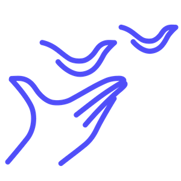

  

<h1 align="center">education</h1>

<i>ODON's education pillar — building the next generation of open data specialists.</i>

  <a href="https://odon.at/en/education/">Website</a> ·
  <a href="mailto:info@odon.at">Contact</a> ·
  <a href="https://github.com/odon-at">github.com/odon-at</a>

---

## About this pillar

ODON builds the next generation of data specialists through online education,
internships, and hackathons — for students and anyone curious about open data. This
repository is the directory of everything ODON publishes on GitHub for that mission:
start here to find the right course.

Public education offerings also include internships (with tracks in Open Data, APIs &
Data Engineering, and Data Analysis & Storytelling) and upcoming online trainings,
webinars, and workshops — see [odon.at/en/education](https://odon.at/en/education/)
and [odon.at/en/internships](https://odon.at/en/internships/) for the current offering
and how to apply.

## Courses

Each course lives in its own repository — see its README for content, format, and how to
get started.

| Repository | Topic |
|---|---|
| [`education-learning-markdown`](https://github.com/odon-at/education-learning-markdown) | Writing clean, well-structured Markdown |
| [`education-learning-git`](https://github.com/odon-at/education-learning-git) | Git & GitHub with real open data |
| [`education-learning-ai-chat-tools`](https://github.com/odon-at/education-learning-ai-chat-tools) | Using AI chat tools effectively |

*More courses will be added here as ODON's education offering grows.*

## Live sessions & meetups

Alongside self-paced material, ODON runs occasional online meetup sessions — dates are
announced on [odon.at](https://odon.at/en).

## Questions or suggestions?

For a specific course, open an Issue in that course's repository. For anything else,
open an [Issue](../../issues) or [Discussion](../../discussions) here, or reach out to
info@odon.at.

## License

Content in this repository and the repositories it links to is licensed under
[**CC BY 4.0**](https://creativecommons.org/licenses/by/4.0/) unless stated otherwise —
feel free to reuse, adapt, and share, with attribution to ODON.

## About ODON

[ODON — Offene Daten für Offene Nutzung](https://odon.at/en) is a Vienna-based,
non-profit association working to lower the barriers to open data through services,
APIs, and education.

---

  ODON – Offene Daten für Offene Nutzung · <a href="https://odon.at">odon.at</a> · <a href="mailto:info@odon.at">info@odon.at</a> · <a href="https://github.com/odon-at">github.com/odon-at</a>

